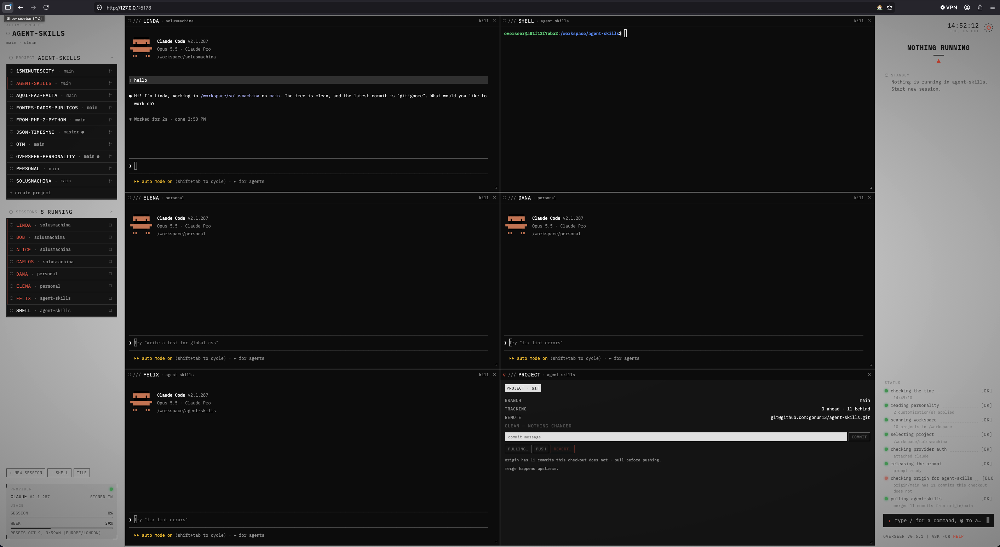
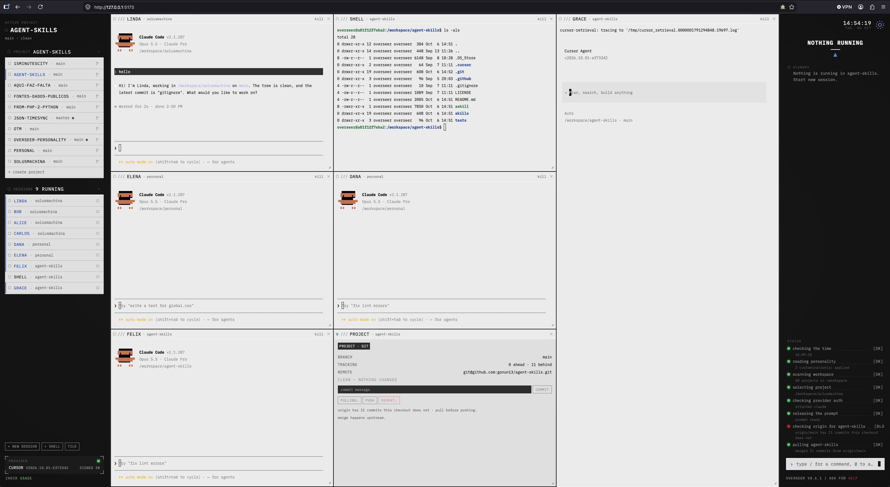

# Overseer

A single-page web console for driving CLI coding agents — Claude Code, Cursor, Codex and opencode — across
many projects at once, each in the CLI's own terminal UI. Built sandboxed, with the paranoid in
mind: agents run in Docker, not on your desktop, so they cannot wipe your home directory or reach
your real accounts. The cost is a browser terminal instead of your own, and a Docker footprint
instead of a single binary.

<p>
  
  
</p>

- **Consoles** — any number of agent, shell (`/shell`) or dev-loop (`/loop`) consoles, tiled on
  one desk. Closing the tab only detaches them; the processes keep running.
- **Sessions** — every provider session in the workspace, read from the CLIs' own transcripts,
  resumable in a new console.
- **Monitoring** — a console waiting on you lights up, and the overseer ranks what needs attention.
- **Callsigns** — every agent has a name; `@linda <message>` prompts Linda, and agents can message
  each other with `overseer tell`.
- **Dev loop** — automated feature/fix workflows for Claude, Cursor and opencode (not Codex); see
  [loop/README.md](loop/README.md).
- **Git over ssh** — generate a key in settings and push from the app or the agent, to any host.

## Install

Requires [Docker](https://docs.docker.com/get-docker/) with Compose. Node, npm and the agent CLIs
all live inside the container.

```sh
git clone https://github.com/gonun13/overseer.git
cd overseer
./bin/start
```

Open http://127.0.0.1:3000 — a wizard walks the fresh instance to a working setup. Type `/help` in
the prompt bar for every command. `./bin/stop` stops it.

Your projects do **not** live in this repo. The first run creates `../overseer-workspace` next to
the clone and mounts it as `/workspace`, the only host surface agents get; clone a project there or
create one from the UI. Keep those projects on git remotes so a bad run is recoverable. To move the
workspace, set `OVERSEER_WORKSPACE_HOST` in `.env` (see [`.env.example`](.env.example)).

Projects that need Docker themselves — to build an image, or because their tests run
`docker compose` — get none by default. Set `OVERSEER_DOCKER=1` in `.env` and restart: Overseer
then runs a Docker daemon of its own for them, never your machine's, behind a filter that refuses
privileged containers and mounts from outside the workspace. [`.env.example`](.env.example) and
[SECURITY.md](SECURITY.md) say what that grants.

A git host on your own machine under a name like `gitlab.local` will not resolve inside the
container, where `127.0.0.1` is the container itself. Point the name at the host in a
`docker-compose.local.yml` (dev: `docker-compose.dev.local.yml`, service `server`), which `bin/`
picks up when present, then restart:

```yaml
services:
  overseer:
    extra_hosts: ["gitlab.local:host-gateway"]
```

Use the name only, and don't join the git host's Docker network
([spec/architecture.md §6.4](spec/architecture.md#64-names-that-mean-the-host)).

> [!WARNING]
> There is no authentication. Overseer is for a single developer on their own machine — do not
> expose it on a public interface or deploy it as a public instance. [SECURITY.md](SECURITY.md)
> states the threat model and how to report a vulnerability privately.

## Upgrade

```sh
./bin/stop
git pull
./bin/start
```

`./bin/start` rebuilds the image on every run, so there is no separate build step. Stopping ends
every running console; their sessions stay resumable from the sessions list. Logins, settings and
the workspace survive, because they live outside the image. `/changelog` in the app lists what
changed, and a release that needs a manual step says so there.

## Back up

Your projects are ordinary directories in the workspace; back them up like any other code. The
rest of the instance's state lives in three Docker volumes that no host directory mirrors:

| Volume                     | Holds                                                          |
| -------------------------- | -------------------------------------------------------------- |
| `overseer_agent-home`      | every provider's login and config, the ssh key, git identity   |
| `overseer_overseer-memory` | the overseer's memory: theme, callsigns, logs, action register |
| `overseer_loop-db`         | the dev loop's requests, plans and per-project memory          |

Stop the stack, then archive each one:

```sh
./bin/stop
mkdir -p ../overseer-backup
for v in agent-home overseer-memory loop-db; do
  docker run --rm -v "overseer_$v:/data:ro" -v "$PWD/../overseer-backup:/backup" \
    alpine tar czf "/backup/$v.tgz" -C /data .
done
```

To restore, stop the stack and unpack an archive back into its volume; this replaces what the
volume holds:

```sh
docker run --rm -v overseer_agent-home:/data -v "$PWD/../overseer-backup:/backup" \
  alpine sh -c 'find /data -mindepth 1 -delete && tar xzf /backup/agent-home.tgz -C /data'
```

The `agent-home` archive contains live credentials — store it as you would a password file. Losing
it only costs you a fresh login per provider and a new ssh key; `loop-db` cannot be regenerated.
With Docker turned on there are two more, `overseer_dind-storage` and `overseer_dind-socket`: a
build cache and a socket, neither worth backing up.

## Develop

```sh
./bin/dev-start
```

Vite on http://127.0.0.1:5173 (hot reload), API on http://127.0.0.1:3001, so it runs alongside
production. Never use host `npm` or Node: dependency work is `./bin/npm`, and `./bin/check` and
`./bin/test` verify. Each `bin/` script documents its options in its header. The spec lives under
[`spec/`](spec/PROJECT.md); contributor rules are in [AGENTS.md](AGENTS.md).

Themes inspired by Person of Interest, created by Jonathan Nolan.

License: [MIT](LICENSE)
